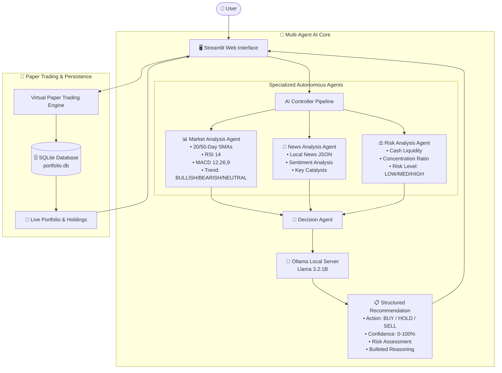

# Reasoning Is All You Need

### A Multi-Agent AI System for Intelligent Stock Analysis and Paper Trading

[](https://www.python.org/)
[](https://streamlit.io/)
[](https://ollama.ai/)
[](https://www.sqlite.org/)
[]()

---

## 📌 Project Overview

**"Reasoning Is All You Need"** is an autonomous, multi-agent AI financial analysis and paper-trading platform developed for **B.Tech Computer Science & Engineering (AI / Agentic AI)** laboratory coursework.

The project models an institutional investment committee where four specialized AI agents collaborate to evaluate stocks from multiple perspectives—**Quantitative Technical Analysis**, **Fundamental News & Catalyst Sentiment**, and **Portfolio Risk Management**—before synthesizing a final **BUY / HOLD / SELL** decision powered by a locally hosted **Llama 3.2:1B** Large Language Model via **Ollama**.

The system is completely **self-contained, private, and offline-capable**. It operates without any paid cloud APIs, external stock tickers, or API keys, using locally generated demonstration datasets and SQLite for real-time virtual paper trading.

---

## 🎯 Problem Statement

Traditional retail stock trading tools suffer from two main flaws:
1. **Isolated Metrics:** Retail investors often look only at chart indicators or only at headlines, ignoring portfolio risk concentration and capital allocation.
2. **Black-box / Hallucinating AI:** Asking a monolithic LLM to predict stock prices or calculate numerical formulas leads to arithmetic hallucinations and unreliable financial advice.

**Our Solution:** A **Modular Multi-Agent Architecture** where:
- **Python / Pandas** handles strict numerical computations (Moving Averages, RSI, MACD, Portfolio P/L).
- **Specialized Agents** handle domain-specific evaluations (Market trends, News sentiment, Risk limits).
- **Llama 3.2:1B** acts as the Chief Investment Officer, synthesizing structured evidence into reasoned, explainable decisions.

---

## 🚀 Key Features

* 📊 **Multi-Agent Collaborative Reasoning:** 4 independent agents (Market, News, Risk, Decision) working in a sequential pipeline.
* 🔒 **100% Local & Free AI:** Powered by Ollama and `llama3.2:1b` with zero cloud dependencies and zero API costs.
* 📈 **Technical Analysis Suite:** Real-time computation of 20-Day & 50-Day SMAs, Relative Strength Index (RSI 14), and MACD (12, 26, 9) with interactive Plotly candlestick charts.
* 📰 **Local News & Sentiment Analyzer:** Multi-category news dataset (Earnings, Business, Technology, Expansion, Management) with automated LLM sentiment scoring.
* ⚖️ **Risk & Capital Preservation Agent:** Monitors cash liquidity, asset concentration ratios, and sector diversification.
* 💸 **Virtual Paper Trading Terminal:** Real-time BUY and SELL execution with ₹10,00,000 initial virtual cash.
* 💼 **Live Portfolio Tracking:** Dynamic tracking of cash balance, invested capital, current valuation, unrealized profit/loss, and return %.
* 📜 **SQLite Transaction Audit Log:** Persistent, transparent recording of every trade with timestamps and price fills.
* 🎨 **Modern Dark-Themed UI:** Responsive Streamlit dashboard with custom CSS, visual metrics, and agent inspection tabs.

---

## 🏗️ System Architecture



---

## 🤖 Detailed Multi-Agent Breakdown

| Agent Name | Primary Responsibility | Input Data | Output | Processing Type |
| :--- | :--- | :--- | :--- | :--- |
| **1. Market Analysis Agent** | Computes technical indicators and identifies directional price momentum. | Historical OHLCV CSV data | Trend (`BULLISH`, `BEARISH`, `NEUTRAL`), SMAs, RSI, MACD, Key technical signals | **Deterministic Python & Pandas** |
| **2. News Analysis Agent** | Analyzes corporate news, earnings reports, and macroeconomic developments. | `data/news/news.json` | Sentiment (`POSITIVE`, `NEUTRAL`, `NEGATIVE`), 2-line summary, key business factors | **LLM (Llama 3.2:1B)** |
| **3. Risk Analysis Agent** | Analyzes available virtual cash, position sizing, and portfolio concentration. | SQLite holdings & proposed trade size | Risk Level (`LOW`, `MEDIUM`, `HIGH`), Risk Score (1-10), Risk bullet points | **Deterministic Python Rules** |
| **4. Decision Agent** | Synthesizes technical, fundamental, and risk findings into a final trade action. | Market Report + News Report + Risk Report | **Recommendation** (`BUY`/`HOLD`/`SELL`), **Confidence %**, **Risk Rating**, **Numbered Reasons** | **LLM Cognitive Synthesis (Llama 3.2:1B)** |

> **Key Viva Principle:** Python handles exact mathematics and data manipulation; the LLM provides contextual interpretation, synthesis, and natural language reasoning.

---

## 💻 Technology Stack

* **Programming Language:** Python 3.10+
* **User Interface:** Streamlit (Custom Dark CSS Theme)
* **AI Model:** Llama 3.2:1B (via Ollama local inference server)
* **Data Processing:** Pandas, NumPy
* **Interactive Visualizations:** Plotly Graph Objects & Subplots
* **Database & Persistence:** SQLite 3
* **HTTP Client:** Requests

---

## 📂 Project Structure

```text
reasoning-is-all-you-need/
│
├── app.py                     # Main Streamlit Dark Dashboard
│
├── agents/                    # Multi-Agent Core
│   ├── __init__.py
│   ├── market_agent.py        # Agent 1: Quantitative Technical Analysis
│   ├── news_agent.py          # Agent 2: News Sentiment & Catalysts
│   ├── risk_agent.py          # Agent 3: Portfolio Concentration & Risk
│   └── decision_agent.py      # Agent 4: Chief Reasoning Orchestrator
│
├── services/                  # Backend Services
│   ├── __init__.py
│   ├── ollama_service.py      # Local Ollama REST Client (Llama 3.2:1B)
│   └── stock_service.py       # Stock Data & News Ingestion Service
│
├── database/                  # SQLite Persistence
│   ├── __init__.py
│   └── database.py            # Paper trading engine, holdings & transactions
│
├── utils/                     # Math & Utilities
│   ├── __init__.py
│   └── indicators.py          # Moving Averages, RSI 14, MACD calculations
│
├── data/                      # Local Datasets (No External APIs)
│   ├── stocks/
│   │   ├── TCS.csv            # ~130 rows of OHLCV data
│   │   ├── INFY.csv
│   │   ├── RELIANCE.csv
│   │   ├── HDFCBANK.csv
│   │   └── AAPL.csv
│   │
│   └── news/
│       └── news.json          # 35+ structured news articles
│
├── generate_data.py           # Dataset Generator Utility
├── test_system.py             # Automated Unit & Integration Test Suite
├── requirements.txt           # Minimal Clean Dependencies
├── README.md                  # Comprehensive Documentation & Viva Guide
└── .gitignore                 # Standard Python & SQLite ignores
```

---

## 📊 Local Data Declaration

> **⚠️ IMPORTANT NOTICE ON LOCAL DATA:**  
> The stock and news datasets included in this project are locally generated sample data for educational demonstration purposes. They are not live market data and should not be used for actual investment decisions.

The project requires **no internet access or external stock/news API keys** during runtime. All prices, volumes, and articles reside inside the `data/` directory.

---

## ⚙️ Installation & Setup

### 1. Clone or Open Workspace
Ensure you are in the project root directory:
```bash
cd "c:\Users\vihaa\Downloads\agentic ai project"
```

### 2. Create and Activate Virtual Environment
**Windows (PowerShell / Command Prompt):**
```bash
python -m venv venv
venv\Scripts\activate
```

**macOS / Linux:**
```bash
python3 -m venv venv
source venv/bin/activate
```

### 3. Install Dependencies
```bash
pip install -r requirements.txt
```

### 4. Setup Local Ollama and Pull Model
1. Download and install Ollama from [https://ollama.ai](https://ollama.ai).
2. Start Ollama and pull the lightweight Llama 3.2:1B model:
```bash
ollama pull llama3.2:1b
```
3. Verify model installation:
```bash
ollama list
```

### 5. Run Automated Tests
Verify that all 4 agents, indicators, and the database engine pass validation:
```bash
python test_system.py
```

### 6. Launch Application
```bash
streamlit run app.py
```
Open your browser at `http://localhost:8501`.

---

## 🔄 Complete Execution Walkthrough

```text
User selects Stock (e.g., TCS) & Proposed Quantity (10 Shares)
                        │
                        ▼
             [ AI ADVISOR CLICKED ]
                        │
       ┌────────────────┼────────────────┐
       ▼                ▼                ▼
[ Market Agent ] [ News Agent ]   [ Risk Agent ]
  Calculates:      Parses Local     Analyzes Cash,
  • 20-Day MA      News JSON        Concentration,
  • 50-Day MA      Evaluates        and Existing
  • RSI (14)       Sentiment        Exposure
  • MACD           (POSITIVE)       (MEDIUM RISK)
  (BULLISH)
       └────────────────┬────────────────┘
                        │
                        ▼
               [ Decision Agent ]
          Constructs Unified Context
                        │
                        ▼
              [ Llama 3.2:1B LLM ]
         Synthesizes Multi-Factor Evidence
                        │
                        ▼
       [ Recommendation: BUY (84% Confidence) ]
       [ Reasons: 1. Price > 20/50 MAs, 2. Positive AI contracts, 3. Low risk ]
                        │
                        ▼
             [ User Clicks Paper BUY ]
                        │
                        ▼
          [ SQLite Database Execution ]
       • Deducts ₹39,500 Virtual Cash
       • Credits 10 TCS Shares to Holdings
       • Records Timestamped Transaction Log
                        │
                        ▼
          [ Dashboard & Portfolio Updated ]
```

---

## 🗄️ Database Schema (SQLite)

The application automatically provisions `data/portfolio.db` with three relational tables:

### 1. `portfolio_meta`
Tracks the global virtual cash balance.
* `key` (TEXT PRIMARY KEY) - e.g. `'cash_balance'`
* `value` (REAL) - Current virtual liquid capital (Initial: `₹10,00,000.00`)

### 2. `holdings`
Tracks currently owned stock assets.
* `id` (INTEGER PRIMARY KEY AUTOINCREMENT)
* `symbol` (TEXT UNIQUE) - Stock ticker (e.g. `'TCS'`)
* `quantity` (INTEGER) - Total shares currently held
* `average_price` (REAL) - Weighted average purchase price

### 3. `transactions`
Immutable audit log of all paper trades.
* `id` (INTEGER PRIMARY KEY AUTOINCREMENT)
* `symbol` (TEXT) - Stock ticker
* `type` (TEXT) - Order type (`'BUY'` or `'SELL'`)
* `quantity` (INTEGER) - Number of shares traded
* `price` (REAL) - Executed price per share
* `total` (REAL) - Total order value
* `timestamp` (TEXT) - Execution date and time (`YYYY-MM-DD HH:MM:SS`)

---

## 🎓 Viva Voce Q&A Guide (B.Tech CSE Agentic AI)

### Q1: What makes this an "Agentic AI" system rather than a simple chatbot?
**Answer:** In a standard chatbot, a single prompt is passed to an LLM to generate text. In our agentic system:
- Work is decomposed into **4 specialized autonomous agents**, each with dedicated goals, isolated contexts, and specific evaluation metrics.
- Computations are grounded in exact deterministic code (Python/Pandas) rather than trusting LLM hallucinations.
- Agents interact hierarchically: sub-agents gather domain-specific intelligence and the Decision Agent acts as the cognitive synthesizer.

### Q2: Why is Python used for indicators instead of asking Llama 3.2:1B to calculate them?
**Answer:** Large Language Models are probabilistic token predictors, not numerical calculators. Prompting an LLM to compute RSI or moving averages from raw numbers results in arithmetic errors and hallucinations. By delegating mathematical computations to Python and Pandas, we guarantee 100% mathematical precision while using the LLM for high-level semantic interpretation.

### Q3: How does the Risk Agent prevent bad trades?
**Answer:** The Risk Agent evaluates portfolio state from SQLite. It checks:
1. Liquid cash affordability (`order_cost <= cash_balance`).
2. Single-stock concentration ratio (rejecting or raising risk if a single asset exceeds 20–40% of net worth).
3. Sector diversification (flagging over-exposure to a single sector like Information Technology).

### Q4: Why choose Ollama and Llama 3.2:1B?
**Answer:** 
1. **Privacy & Security:** All data and prompts remain strictly on the local machine.
2. **Cost-Effective:** Zero recurring cloud API token costs.
3. **Low Latency & Modest Resource Footprint:** Llama 3.2:1B requires only ~1.3 GB of VRAM/RAM and runs smoothly on standard student laptops without dedicated high-end GPUs.

### Q5: How is the Average Buy Price calculated during consecutive BUY orders?
**Answer:** Using the weighted average cost formula:
$$\text{New Average Price} = \frac{(\text{Existing Quantity} \times \text{Existing Avg Price}) + (\text{New Quantity} \times \text{New Price})}{\text{Existing Quantity} + \text{New Quantity}}$$

---

## ⚠️ Limitations & Future Enhancements

### Current Limitations:
- Uses locally generated historical stock and news datasets (no real-time internet feeds).
- Paper trading only (no real financial transactions or live broker connections).
- Fixed universe of 5 demonstration assets (`TCS`, `INFY`, `RELIANCE`, `HDFCBANK`, `AAPL`).

### Future Roadmap:
- [ ] Integration with live WebSocket feeds for tick-by-tick market depth.
- [ ] Advanced algorithmic order types (Stop-Loss, Take-Profit, Trailing Stops).
- [ ] Multi-user authentication and simulated trading leaderboards.
- [ ] Voice-based conversational trading assistant.

---

## 📜 Disclaimer

> **Educational Disclaimer:** This software is developed strictly for educational and academic research purposes as part of a B.Tech Computer Science & Engineering degree curriculum. It utilizes synthetic demonstration data and paper-trading mechanisms. It does not provide financial advice, make guarantees regarding stock performance, or execute real monetary transactions.
